<p align="center">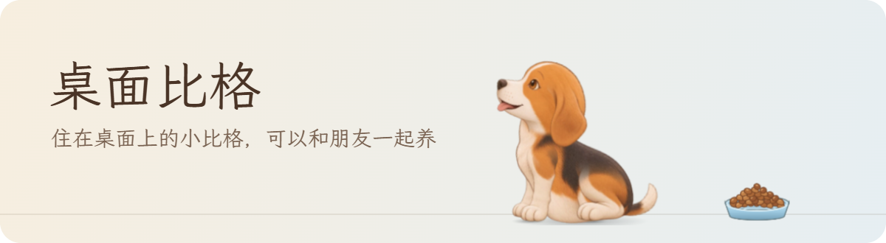</p>

一只住在 Windows 桌面上的小比格。它待在壁纸上面、所有程序窗口下面，自己溜达、闻来闻去、犯困了趴下睡；饿了去碗边等饭，你走开了它就睡，你回来它跑过来迎你。

可以拉两三个朋友一起养。狗一次只在一个人的桌面上，会自己去别人那儿串门，还能帮你们叼纸条。

<p align="center">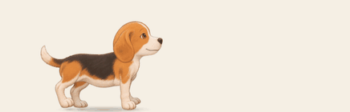</p>

**下载**：到 [Releases](https://github.com/Tangtang232/desktop-pet/releases/latest) 下载 `DesktopPet-Setup-<版本>.exe`，双击就装好，装好就能和朋友一起养（详见[下载和安装](#下载和安装)）。

产品需求见 [docs/PRD.md](docs/PRD.md)，合养的实现见 [docs/m2-together.md](docs/m2-together.md)，开发和测试规范见 [docs/pet-sop.md](docs/pet-sop.md)，美术需求见 [docs/art/](docs/art/)。

## 它平时干什么

<p align="center">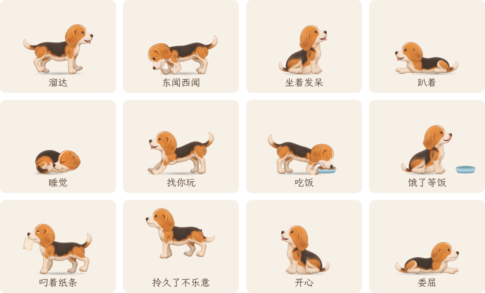</p>

- 精力、无聊、想被理三个看不见的需求决定它下一步做什么：累了趴下睡，无聊了邀你玩；你在电脑前却很久不理它，它会跑到鼠标附近坐着看你，还不理就委屈地趴下
- 饿分几档：先是偶尔瞟一眼碗，再去碗边坐着等，等久了委屈。肚子大约 8 小时消化完，程序关着时也照算
- 你键鼠 5 分钟没动（或锁屏），它就去睡；你回来它醒过来，伸个懒腰跑过来迎你
- 晚上更容易犯困

| 睡醒伸懒腰 | 摸摸头 |
|:---:|:---:|
| 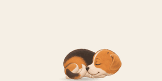 | 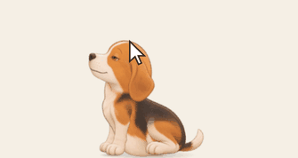 |
| **倒一碗粮，走过去吃** | **叼着纸条出门** |
| 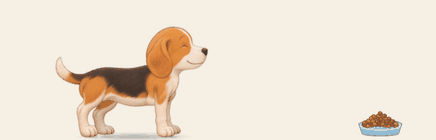 | 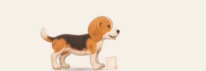 |

## 怎么和它玩

- 鼠标移到它身上可以点，其他地方的点击照常落到桌面
- 按住拖动：拎起来，松手会掉下去；拎太久它会挣扎，落地后抖抖毛
- 点一下：吓它一跳
- 鼠标在它头上来回划：摸摸，会眯眼摇尾巴
- 鼠标在附近晃：它会转头看你
- 鼠标在它旁边停着不动（比如你要点它身后的东西）：它会变淡，停久了自己走开
- 右键它或点托盘图标：喂一碗、写张纸条让它带走、它的日记、一起养、藏起来、开机自动启动、退出。站、坐、趴、睡这些都是它自己随机决定的，不能手动摆
- 两块屏幕左右挨着：你在另一块屏幕上干活一阵子，它会走过去找你；拎着它拖过屏幕边也行
- 万一它挡住了桌面点不动：托盘图标右键 → 暂时藏起来，之后再叫它回来

## 叼纸条

右键 →「写张纸条让它带走」，写好点「交给它」。它低头叼起纸条，走出屏幕边。

- 一起养时：纸条送到对方桌面，放在对方鼠标附近，坐着等对方看。组里三个人以上时，在纸条里写 `@昵称` 选寄给谁（上面的小标签点一下就能插入）。对方不在电脑前，它会等对方回来再送
- 没一起养时：它在外面转一圈，把纸条叼回来放在你鼠标附近

地上的纸条点一下展开看，点「收好」它会开心地蹦一下。3 分钟没人看，它会自己叼走收起来；收起来的算"没看"，托盘菜单里会出现「看纸条（N 张没看）」。

<p align="center"></p>

## 和朋友一起养

托盘 →「一起养…」。一个人点「邀请朋友一起养」拿到邀请码，发给朋友；朋友点「输入邀请码」，组里的人同意后就进来了。两个人才算一起养：只有自己时只是发出了邀请，狗还是你自己的；朋友进来的那一刻才开始。邀请不过期，不想邀请了点「不邀请了」。一个组最多 4 个人。

| 还没一起养 | 一起养着 |
|:---:|:---:|
| 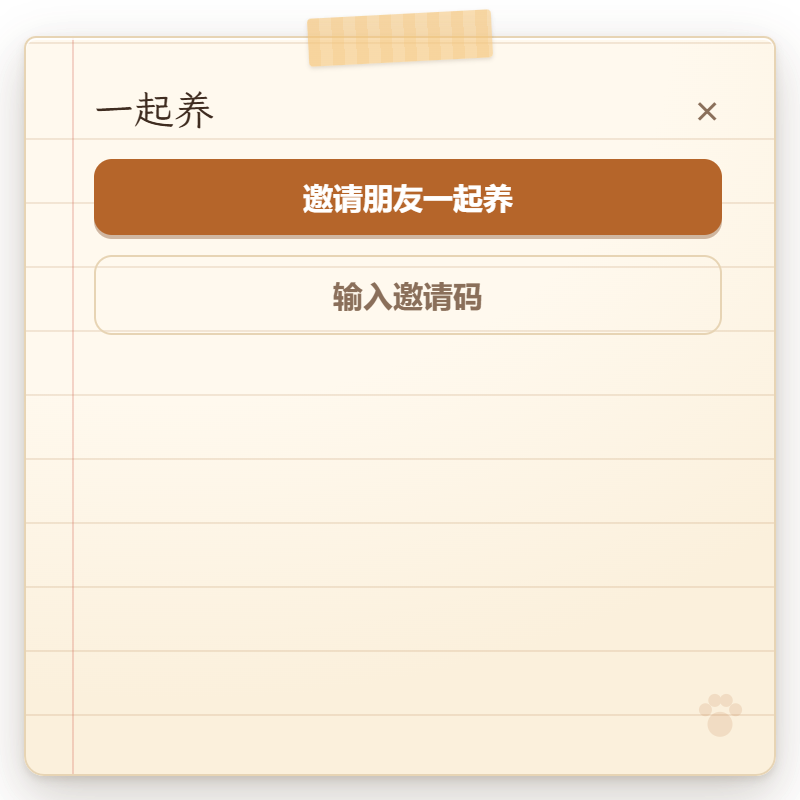 | 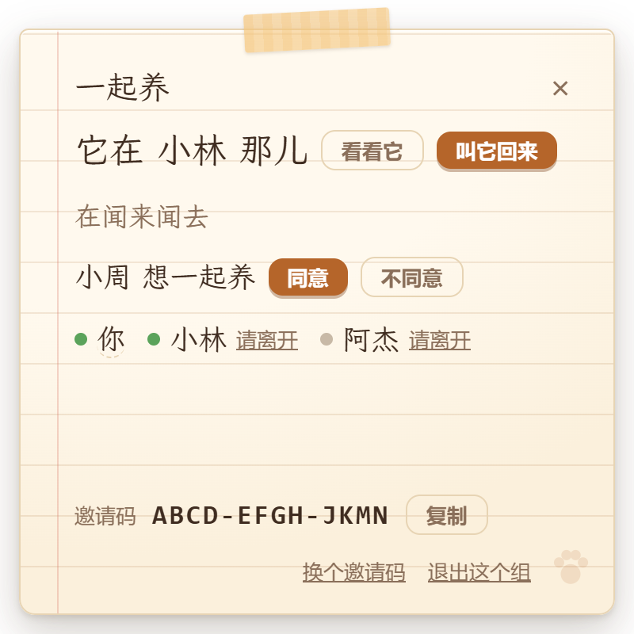 |

<sub>截图里的名字和邀请码都是假数据。</sub>

- **它在谁那儿**：狗一次只在一个人的桌面上。到了一个人那儿至少待 10 分钟（有纸条要送、主人走开了例外），之后按"多久没见到它了"和"对它好不好"（心动值）随机去别人那儿，两边心动值都一般时平均二十来分钟串一次门。主人键鼠 5 分钟没动、另一个人在电脑前，它过两分钟就过去找在的那个人
- **叫它回来**：它在别人那儿时可以叫它回来，10 分钟叫一次；它刚到对方那儿不满 5 分钟不走（对方不在电脑前除外）
- **看看它、隔空喂一碗**：它在别人那儿时点一下碗，或者在一起养窗口里点「看看它」，能看到它在对方桌面上的样子（几秒一张小图，只有狗，没有对方的桌面），还能隔空给它倒一碗粮
- **一个人几台电脑**：狗跟着你正在用的那台走。换了新电脑输邀请码时选「以前就在这个组里，换了电脑？」，从名单里认回自己，再在你原来那台电脑上点「是我」；原来那台不在手边，就要组里其他人都同意。只有你一个人的组，原来那台 7 天没开过才凭邀请码直接认回（不然拿到邀请码的人就能冒充你）
- **换码、退出、请人离开**：收在窗口最下面的小字里，点了还要再确认一次。三个人以上时可以提议请某人离开，其他人都同意才算，请走以后旧邀请码马上作废。最后一个人退出，组就散了

<p align="center">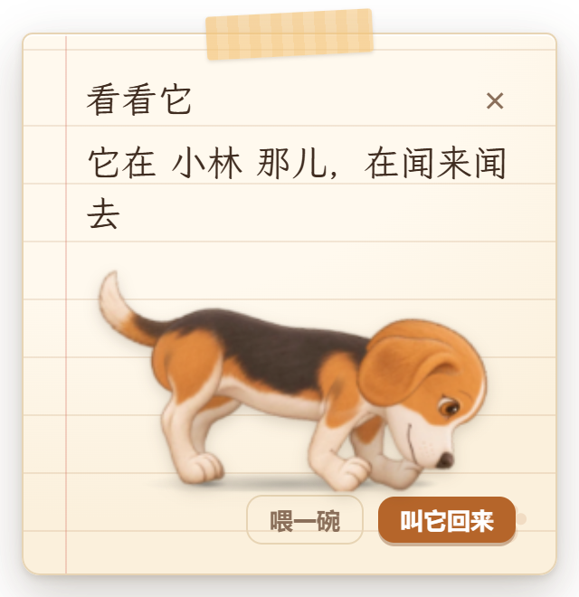</p>

狗换地方是这样走的：

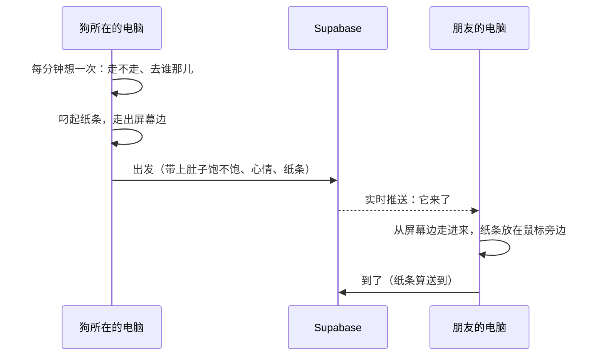

隐私和安全：

- 每台电脑用 Supabase 匿名登录，不用注册、不填手机号邮箱
- 纸条和"看看它"的小图用组钥加密（AES-256-GCM）后才上传；组钥用邀请码派生的钥匙包着；邀请码在服务器上只有哈希和一份加密的副本
- 本机的登录凭据、邀请码、组钥用系统加密（Windows DPAPI）存着。每台电脑还有一把只在本机的认领钥匙（服务器上只有它的哈希）：服务器那边的登录作废了，这台电脑凭它自己认回原来的身份，不会悄悄掉出组
- 服务器有容量保护：全站每小时最多建 30 个组，没人在看时不收"看看它"的小图，过期的试码记录、旧小图每小时清一次
- 客户端只用 Supabase 的公开密钥，读权限靠服务器上的行级权限规则（RLS），写操作一律走服务器函数，函数里校验身份和次数。配置里误填了 Secret / service_role 密钥，程序会拒绝联网

## 它的日记

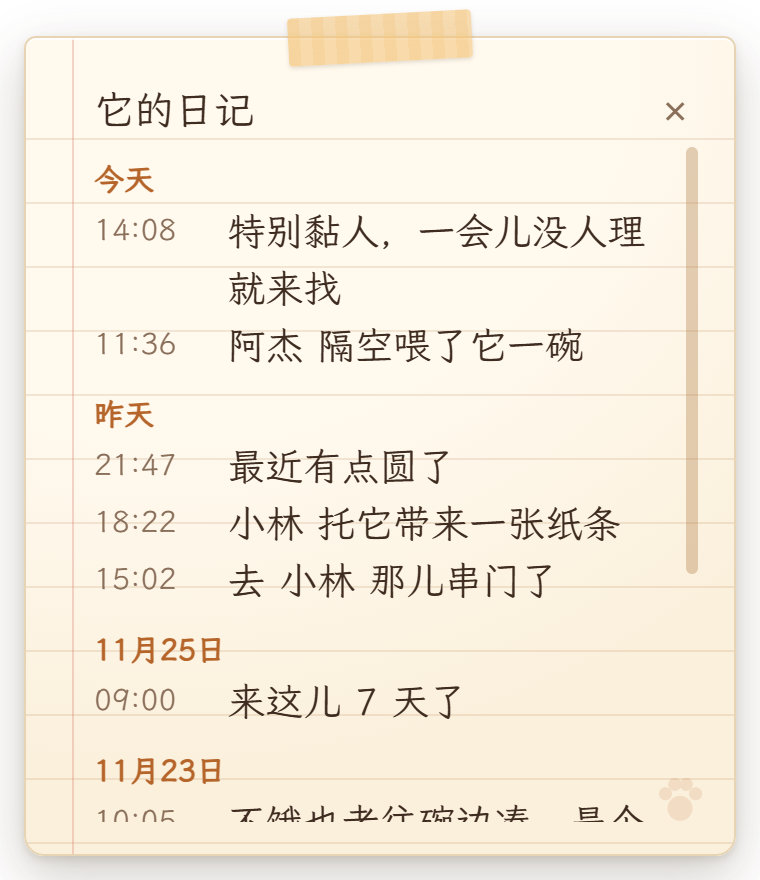

每只狗生下来就有自己的脾气：胃口大小、馋不馋、精力、黏不黏人、好不好奇，影响它多久饿、多爱往碗边凑、走得多还是趴得多、多久来找你一次。一起养时组里每个人看到的是同一只狗、同一副脾气。

脾气不会直接告诉你，要你自己看出来：它的某种表现攒够了次数，日记里就记一笔，比如"不饿也老往碗边凑，是个小馋鬼"。

它也会慢慢变：

- 你常摸它、陪它玩，它会越来越亲人；老不理它，会有点冷淡。一天变不了多少，一阵子不管也会慢慢回到原样
- 老是吃得很撑会变圆（肚子看得出来），老饿着、走得多会瘦
- 来了 7 天、30 天、100 天……日记里都记着；从谁那儿过来、谁隔空喂了它一碗，也记着

日记只记在本机，组里几个人各记各的。

<br clear="right">

## 不打扰别的程序

它是一直挂着的东西，所以给自己定了几条规矩（细节见 [docs/pet-sop.md](docs/pet-sop.md) 5.4）：

- 不抢焦点：点它不会把你正在用的程序切走；写纸条、一起养这些小窗口在你切到别的程序后不再压在最上面
- 待在桌面层：在壁纸和桌面图标上面、所有程序窗口下面（Windows 上用 koffi 调系统接口）。全屏游戏、放映自然会盖住它。别的程序也在抢最底层时它会退让，不会和对方来回抢
- 只接自己身上的点击：鼠标在狗身上、并且系统确认这一下点击会交给狗的窗口或桌面时才算点狗。开始菜单、弹出菜单、任务栏盖在它上面时，点那些地方不会把狗拎起来
- 不占用任何系统快捷键，不会和别的程序抢组合键
- 整只被窗口盖住时停止绘制，只在后台算消化
- 看门狗：动画每走一帧才报一次平安，4 秒没消息先恢复点穿，9 秒没消息重载页面（刚开机素材还在解码时宽限到 60 秒，睡醒不算），卡死的页面先结束掉再重载。显卡上下文丢了 10 秒没恢复也重载
- 存档：先写临时文件、强制落盘再改名，每小时留一份 .bak；读不了就用备份，坏的那份改名留底。页面没读到存档之前不存档（以前开机慢时可能把存档盖成一只新狗）；存档是更新版本写的，旧版本只读不写
- 页面没有 Node 权限，只能用 preload 暴露的几个接口；拖进窗口的文件、链接不会把窗口换掉。主进程出了意外的错只记进诊断记录，不弹报错框
- 只连两个地方：Supabase（一起养，没配置就不连）和 GitHub（装好的版本每 12 小时问一次最新版本号，请求里不带任何个人信息）。不开任何监听端口

## 下载和安装

到 [Releases 页面](https://github.com/Tangtang232/desktop-pet/releases/latest)下载，两个文件选一个：

| 文件 | 适合谁 |
|---|---|
| `DesktopPet-Setup-<版本>.exe` | 大多数人。双击就装好并自动打开 |
| `DesktopPet-<版本>-win-x64.zip` | 不想安装，或者电脑不让装程序。解压到一个固定的文件夹，双击里面的 `DesktopPet.exe` |

页面最下面的 Source code 是源码，不是程序，不用下。

- 两个都带着联网配置，打开就能一起养：朋友把邀请码发给你，托盘 →「一起养…」→「输入邀请码」
- 没有数字签名，Windows 会弹蓝色的"Windows 已保护你的电脑"：点"更多信息"→"仍要运行"。公司电脑可能直接拦掉，要签名证书才能解决（还没买）。不放心的话可以对一下 Releases 里 `SHA256SUMS.txt` 的校验值
- 安装版不用管理员权限，装在自己的用户目录下（`%LOCALAPPDATA%\Programs`），开始菜单里会有"桌面比格"。不建桌面快捷方式，开机自启默认关着，想要就在托盘菜单里勾上
- 压缩包版别解压在下载文件夹里随手就删了；勾了开机自启以后别挪文件夹。不用了直接删文件夹
- 卸载：开始菜单或"设置 → 应用"里卸载。卸载不删存档：狗、纸条、合养都存在 `%APPDATA%\desktop-pet`，重装后狗还是那只。安装版和压缩包版用的是同一份存档
- 新版本：装好的版本每 12 小时看一眼 GitHub，有新版本时托盘菜单最上面多一条「有新版本 x.y.z，去下载」，点了用浏览器打开下载页（同一个版本只弹一次托盘提示）。它不会自己下载、自己安装。安装版直接运行新的安装包，装在原来的位置上；压缩包版先从托盘退出，再解压覆盖原来的文件夹。存档都不动。托盘 →「关于」里能手动检查
- 出了问题：托盘 →「关于」→「复制诊断信息」，粘贴发给维护的人。里面是版本、系统、屏幕、一起养的状态和最近的诊断记录，没有邀请码、纸条和名字

## 从源码运行

需要 Windows 和 Node.js 18 以上（现在开发用的是 Node 26）。

```
npm install
npm start
```

如果启动时报找不到 Electron 可执行文件（新版 npm 默认不跑依赖的安装脚本），手动下载一次：

```
node node_modules/electron/install.js
```

开发模式会把页面日志打到终端；饿和消化加快 60 倍，需求变化加快 20 倍，键鼠 20 秒不动就算你离开了，方便看变化：

```
npm run dev
```

安装版和从源码跑的用同一个存档目录、同一把单实例锁：两个不会同时开出两只狗。换成安装版之前，先从托盘退出源码跑的那只。

### 联网配置

仓库里的 `config/supabase.json` 就是一起养连的那个 Supabase 项目（地址和公开密钥），从源码跑也能直接和用下载版的朋友一起养，什么都不用配。公开密钥本来就是给客户端用的，装好的程序里本来也带着；数据安全靠服务器上的行级权限规则（RLS）和服务器函数里的校验，不靠藏密钥。Secret / service_role 密钥绝不能放进来，程序发现了会拒绝联网。

想连自己搭的项目（比如改了数据库要先试）：

1. 在 [Supabase](https://supabase.com) 建一个项目，在 Authentication 里打开匿名登录（Anonymous sign-ins）
2. 在 SQL Editor 里按文件名顺序跑一遍 `supabase/migrations/` 下的 SQL
3. 把 `config/supabase.example.json` 复制成 `config/supabase.local.json`，填上那个项目的地址和公开密钥。它比 `supabase.json` 优先，只留在本机，不进 git，也不会打进安装包

自己搭的是另一套独立的服务，和用下载版的朋友不在一起。

## 打包和发布

```
npm run dist        # 先检查联网配置能用，再打安装包和压缩包：
                    #   dist/DesktopPet-Setup-<版本>.exe、dist/DesktopPet-<版本>-win-x64.zip
npm run dist:dir    # 只打成文件夹 dist/win-unpacked，自己试跑用
```

打包工具是 electron-builder，配置在 `package.json` 的 `build` 里。包里只放程序自己的代码、打包好的美术（`rig-data.js`，1 MB）、图标、手写字体和联网配置 `config/supabase.json`。高清原图（`hd-library`）、本机配置（`*.local.json`）、文档、测试都不进包。`config/supabase.json` 不在或填得不对时 `npm run dist` 直接停下，免得打出一个连不上的安装包。第一次打包要从 GitHub 下 NSIS 等几样小工具，之后用本机缓存。

发新版本（在 GitHub 的服务器上打包，本机不用传大文件）：

1. 改 `package.json` 的 `version`（x.y.z，新版本提醒按它比大小），在 `docs/release-notes/<版本>.md` 写这版改了什么
2. `npm test`、`npm run smoke` 过一遍
3. 提交，`git push`
4. 打版本标签并推上去，标签就是 `v` 加版本号：

```
git tag v0.2.0
git push origin v0.2.0
```

GitHub 收到标签后，在它的 Windows 机器上跑单元测试、打安装包和压缩包，传到 Releases，全传完才公开（`.github/workflows/release.yml`，大约十几分钟，进度在仓库的 Actions 页面看）。标签和 `package.json` 的版本对不上会直接停下。装好的版本最晚 12 小时后就会提醒朋友有新版本。

也可以在本机打包、本机上传：`npm run dist` 再 `npm run release`（GitHub 登录用 `GH_TOKEN` 环境变量，没有就用 `git push` 时的那个登录，不打印、不写盘；中途断了再跑一次会接着传；只检查不上传加 `-- --dry-run`）。有的公司网络会拦往外传程序文件，那就用上面的标签方式。

## 测试

```
npm test         # 规则的单元测试：消化、饥饿、需求、选下一个动作、离开期间结算、存档校验、纸条文字、串门规则、成长、本机保险箱
npm run smoke    # 冒烟测试：在不显示的窗口里按剧本跑一遍，截图存到 tools/out/smoke/，最后报告检查结果
```

冒烟测试检查各个姿势和表情能画出来、狗身上可点空白处点穿、喂食、饿了去碗边、人走了睡回来迎接、拎久了挣扎、叼纸条出门再叼回来、存档往返、跨屏幕、成长，自由活动连续跑 5 分钟不出错。打包后的版本也能跑（截图存到系统临时目录的 `desktop-pet-smoke`）：

```
dist\win-unpacked\DesktopPet.exe --smoke
```

存档保护的真实测试（开一个看不见、不联网的副本：开机时页面还没读档就被重载、新版本的存档、写坏的存档，约 1 分钟）：

```
node tools/e2e/save-real.mjs
```

真桌面测试（会动你的鼠标）和合养的端到端测试（开四个看不见的副本、真连 Supabase）见 [tools/e2e/README.md](tools/e2e/README.md)。

冒烟测试覆盖不到、要在真桌面上手动看的：托盘和右键菜单、开机启动、Mac。

### README 的配图

`docs/images/` 里的图是脚本生成的：开一个断网的测试副本让狗按剧本动、逐帧截图拼成动图，小窗口换上假数据截图。不连 Supabase、不动鼠标键盘，也不碰正在养的那只。改了动作或界面以后重新生成（要 Python 和 Pillow）：

```
node tools/docs/shots.mjs
```

## 资源占用

桌宠一直挂着，所以尽量省：

- 窗口平时只盖屏幕底部一条（狗活动的那一带），被拎起来时才临时铺满，落地后缩回去
- 帧率按需要变：被拎、被摸、转身 30 帧；走路、吃饭、换姿势 24 帧；站着坐着趴着 8 帧；睡觉 5 帧；出门送纸条 4 帧；藏起来时不画
- 鼠标位置由主进程每 40 毫秒看一眼，不让系统把每次鼠标移动都转发给页面
- 点击判断只读狗所在那一小块离屏图层

测 CPU：先关掉正在跑的桌宠，然后运行（测的时候别动鼠标）

```
powershell -File tools/bench.ps1
```

2026-11-25 在一台 16 核 Windows 机器上：走路约 7%、坐着约 3.5%、睡觉约 3% 个核（优化前 17%、12%、14%），内存约 370 MB（优化前 550 MB）。数字随机器忙闲会有 ±3 的浮动。之后加了合养和成长，还没重测。

## 换素材

新的分层原图放进 `assets/beagle/hd-library/`（结构见 `docs/art/asset-spec.md`，这个目录不进 git），然后重新打包：

```
python tools/build_hd.py
```

它会把图按 0.5 倍缩小、编成 WebP 写进 `assets/beagle/puppy/rig-data.js`。改完跑一遍 `npm run smoke`，看 `tools/out/smoke/` 里的截图。

## 目录

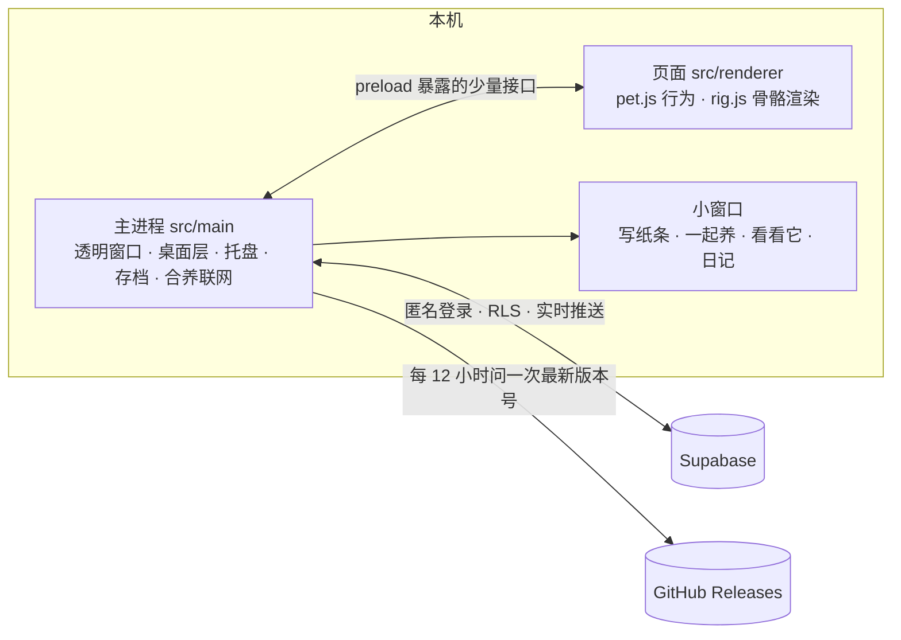

```
src/main/       主进程：透明窗口、桌面层、点穿、看门狗、空闲检测、托盘和右键菜单、小窗口、存档、合养联网（together.js）、
                新版本提醒（update-check.js）
src/preload/    暴露给各个页面的少量接口
src/renderer/   pet.js 行为和每帧姿势；rig.js 分层素材的骨骼网格渲染；logic.js、mind.js、grow.js 和画面无关的规则；
                note / together / watch / diary 四个小窗口；fonts/ 手写字体
src/shared/     visit.js 串门规则（主进程和测试共用）
supabase/       合养的数据库表、权限规则和服务器函数
config/         联网配置 supabase.json（一起养连的 Supabase 地址和公开密钥）；连别的项目用的样例
.github/        推版本标签时在 GitHub 上打包发布的流程
assets/         beagle/puppy/rig-data.js 是打包好给页面用的美术数据（parts.js 是早期低清版，已不用）；icons/ 托盘图标
test/           单元测试
tools/          build_hd.py 打包美术；bench.ps1 测 CPU；e2e/ 真桌面测试；docs/ 生成 README 配图；
                release/ 打包前检查和发布到 GitHub；out/ 中间产物（不进 git）
docs/           产品文档、技术说明、美术需求、早期打样页面、README 配图、每个版本的发布说明（release-notes/）
```

## 现在的限制

- 只在 Windows 上做完了：桌面层、点击归属这些都用了 Windows 接口；Mac 上暂时是不置顶的普通窗口
- 多显示器只认左右挨着的屏幕（上下摆的、隔着一块的，它不会过去）；狗一次只在一块屏幕上，碗跟着它走
- 目前只有幼犬、经典三色一套素材；长大的样子和其他毛色要等素材（见 `docs/art/asset-spec.md`）。碗还是程序画的
- 合养要联网；一台电脑只能进一个组；匿名登录没加人机验证，防刷靠 Supabase 按 IP 限次数和服务器函数里的限制
- 安装包没有数字签名；有新版本会提醒，但要自己下载安装
- 一起养连的 Supabase 项目是免费档：长时间没人用会被 Supabase 暂停，暂停后大家的「一起养」都连不上（单机的狗不受影响），要维护的人去 Supabase 控制台恢复。免费档的实时消息数、流量每月有上限，0.2.0 已经把心跳引起的整套刷新砍掉了，人多了还是要看一眼后台的用量页
- 别在 Supabase 后台批量删匿名用户：组里每台电脑都是一个匿名用户。删了以后新版本能凭本机的认领钥匙自己认回来，0.1.0 会直接掉出组

## 字体和许可

手写字体是[霞鹜文楷](https://github.com/lxgw/LxgwWenKai)裁出常用字后改名的 PetHand，许可是 SIL OFL 1.1，见 `src/renderer/fonts/`。项目代码目前没有附开源许可证。
